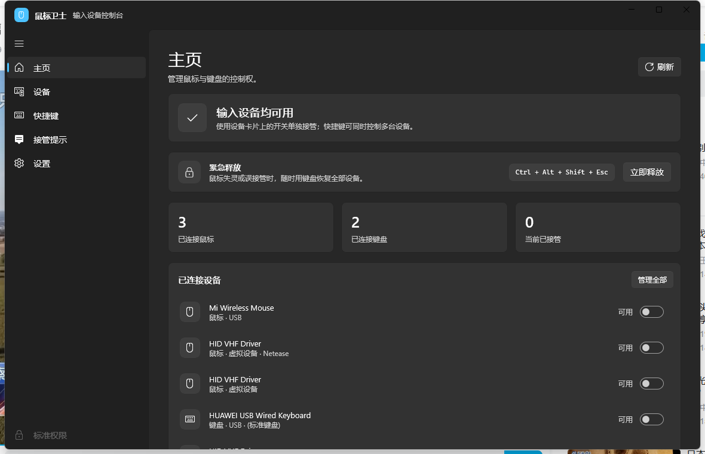
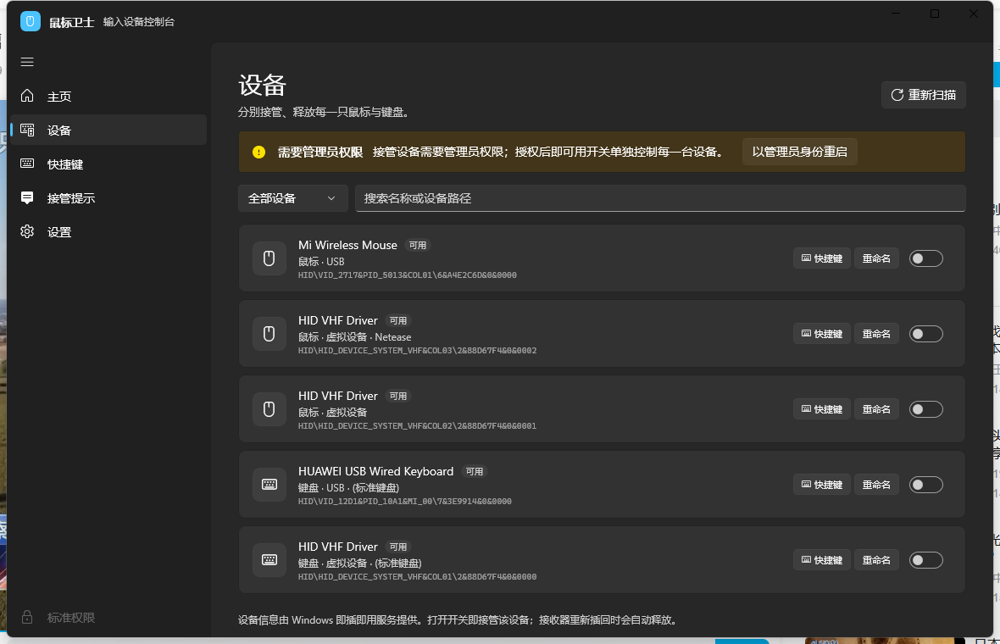
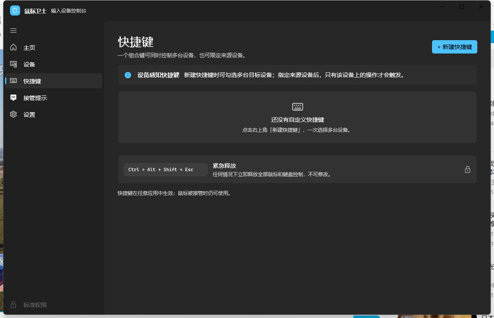
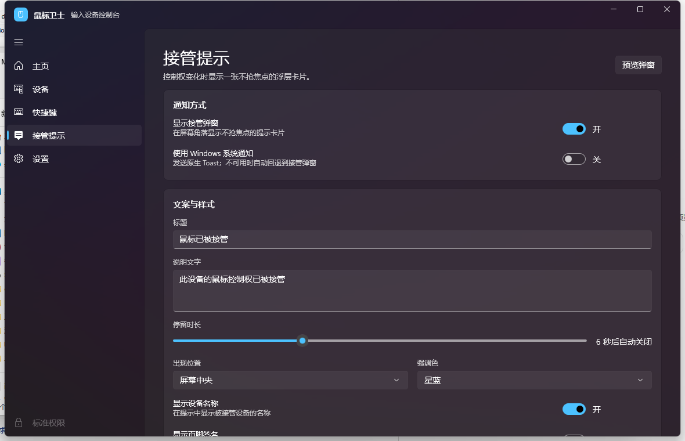
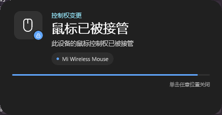
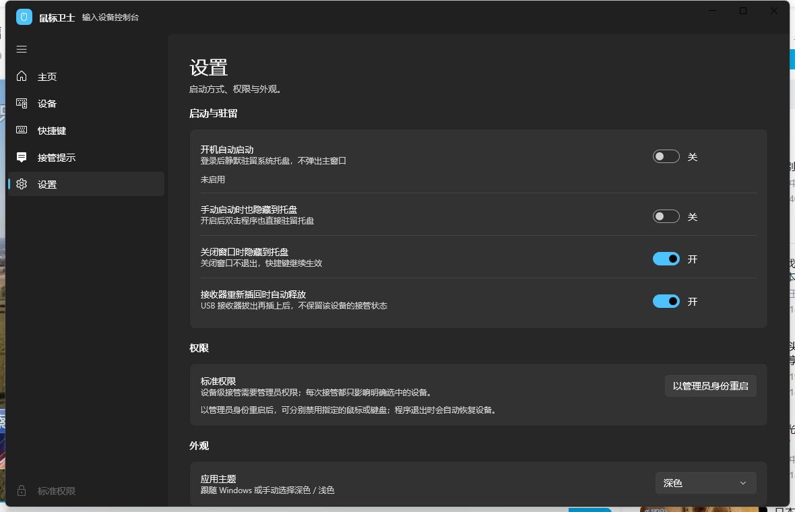

# 鼠标卫士 2.0 · MouseGuard

原生 **WinUI 3 / Windows App SDK** 输入设备控制台，面向 Windows 11。
NavigationView、Mica、Fluent 控件与系统字体，接近 Windows「设置」的原生观感，不使用 WebView 或网页外壳。



## 直接运行

解压后运行：

```text
dist\MouseGuard-2.0.0-final3\MouseGuard.exe
```

- 便携版，无需安装；已内置 .NET 8 与 Windows App SDK 运行时。
- 首次使用建议右键 **以管理员身份运行**，才能用设备开关禁用鼠标/键盘。
- 程序未签名，Windows SmartScreen 可能提示；这是本地工具的正常现象。

## 2.0 的交互

- **设备开关**：设备页和主页都用 WinUI ToggleSwitch 单独接管/释放每一台设备，没有「一键接管全部」。
- **多设备快捷键**：新建快捷键时可勾选一台或多台目标设备；一个组合键同时控制这一组设备。
- **紧急释放**：主页直接显示 `Ctrl + Alt + Shift + Esc`，并保留「立即释放」按钮。
- **接收器热插拔**：已接管设备的 USB 接收器拔出再插回后，程序自动释放该设备，不保留禁用状态。
- **接管提示**：可单独关闭弹窗，或改用 Windows 系统通知；弹窗支持中央/右上/右下位置、倒计时进度条、强调色、设备名和可选页脚。系统通知会在开始菜单创建 `MouseGuard` 快捷方式并写入 AUMID；若策略禁止写入，则回退到托盘气泡提示。
- **快捷键开关**：每个绑定都有「启用」开关，新建/编辑时也可直接停用。
- **托盘驻留**：关闭窗口默认隐藏到托盘；第二次启动会唤醒已经驻留的窗口，而不是静默退出。
- **开机启动**：登录后静默驻留托盘。

## 截图

| 设备开关 | 多设备快捷键 |
| --- | --- |
|  |  |

| 接管提示设置 | 提示浮层 |
| --- | --- |
|  |  |



## 快捷键

没有内置的「接管全部」快捷键。新建快捷键时：

1. 选择动作（切换/接管/释放所选设备，或紧急释放全部）。
2. 在目标设备列表中勾选一台或多台设备。
3. 点击「点击后按下组合键」，按下组合键。

来源设备可选；指定后只有该设备上的操作才会触发。紧急释放 `Ctrl + Alt + Shift + Esc` 不可修改。

## 开发与构建

要求：Windows 11 x64、.NET 8 SDK、Windows App SDK 2.6.5。

```powershell
# 调试构建
.\build.ps1

# 发布便携版到 dist\MouseGuard-2.0.0-final3
.\build.ps1 -Publish
```

如果系统阻止脚本执行：

```powershell
powershell -ExecutionPolicy Bypass -File .\build.ps1 -Publish
```

项目结构：

```text
MouseGuard.WinUI\   原生 WinUI 3 外壳、页面、托盘与浮层
MouseGuard\         可移植业务核心（设备、设置、日志、启动项）；也保留旧 WPF 外壳供对照
docs\               原生界面截图
dist\MouseGuard-2.0.0-final3\  可直接运行的构建产物
```

## 说明

- 单设备接管基于 Windows SetupAPI，需要管理员权限；程序退出时会恢复。
- 接收器热插拔检测通过设备变化通知和 5 秒兜底扫描完成。
- 不安装驱动、不联网、不注入其他进程。
- 当前版本：**2.0.0**。

## 许可证

Original MouseGuard source code is licensed under **GNU GPL version 3 only**
(`GPL-3.0-only`). See [LICENSE](LICENSE).

Copyright (C) 2026 tenkawamira.

Third-party components (notably the Microsoft Windows App SDK and the .NET
runtime) keep their own licenses and are not relicensed by GPL-3.0. See
[THIRD-PARTY-NOTICES.md](THIRD-PARTY-NOTICES.md), especially the note about
self-contained binary distribution.


